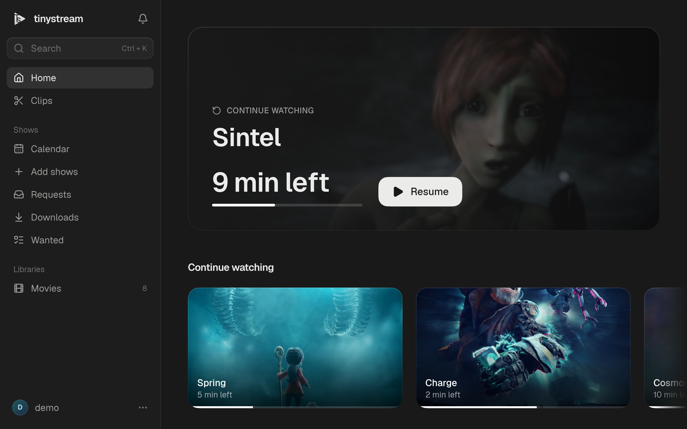

<div align="center">

# tinystream

<picture>
  <source media="(prefers-color-scheme: dark)" srcset="assets/logos/logo-inverted.svg">
  
</picture>

A small self-hosted media server for your shows, movies, music and books.

[](https://github.com/tinystream-dev/tinystream/releases/latest)
[](LICENSE)

<br>



<sub>Films by <a href="https://studio.blender.org/films/">Blender Studio</a>, CC BY.</sub>

</div>

## Features

- Shows, movies, music and books in one binary, with the web app built in
- Subtitles drawn right, styled ASS included, on the web and on Android
- Hardware transcoding with VA-API or NVENC, with a software fallback
- Watch Together and Listen Together
- Clips of any moment, shareable with a link
- Lyrics and loudness normalization, plus OpenSubsonic for the music apps you already use
- Requests, a calendar, and downloads from the RSS and Torznab indexers you add
- Invite links for friends and family
- Tailscale Serve and Funnel, set up for you
- An Android app

## Getting started

Point `/path/to/media` in [`docker-compose.yaml`](docker-compose.yaml) at your media, then:

```sh
mkdir -p config data && sudo chown 1000:1000 config data
docker compose up -d
```

Open <http://localhost:3000> and create the admin account.

Linux binaries for x86_64 and arm64, and the Android app, are on the [releases page](https://github.com/tinystream-dev/tinystream/releases/latest). A [desktop app](https://github.com/tinystream-dev/tinystream/tree/feat/desktop) for Windows, Linux, and macOS is coming soon.

## License

Released under the [AGPL-3.0-or-later](./LICENSE) open-source license. Subtitles are drawn by [rustyass](https://github.com/tinystream-dev/rustyass), our pure-Rust take on libass, under the LGPL.
